<div align="center">



</div>

**CTO** at a product company in Porto. I lead the engineering team and I'm turning the whole
company AI-first — not with slide decks, with services in production.

Before that I ran **Head of AI**, shipping a fleet of AI-powered microservices. Before that I built
a **full chatbot alone** and put it live: six months in production, still running.

I care about the boring half of AI: evals, cost per request, what happens at 2am, whether the thing
still works when the model changes under you.

<div align="center">



</div>

## ▸ Quest log

| act | role | what shipped | status |
| --- | --- | --- | --- |
| **III** | **CTO** | Leading the team; making the company's products and internal tools AI-first. | `ACTIVE` |
| **II** | **Head of AI** | A fleet of AI-powered microservices — design, infra, delivery. | `CLEARED` |
| **I** | **Solo build** | End-to-end chatbot, built alone, in production for 6 months. | `LEGENDARY` |

<div align="center">



</div>

## ▸ Inventory

| item | rarity | what it is |
| --- | --- | --- |
| [Hassius](https://hassius.io) | `LEGENDARY` | Spec-driven dev platform: spec repositories, agent runs, human-gated PRs. |
| **v100_engines** *(private)* | `EPIC` | Modern LLMs serving on a single Tesla V100 — engine survey, quants, measured tok/s. |
| **nonius** *(private)* | `EPIC` | Matemática A practice engine: 158 past exams parsed into structured drills. |
| [free-llm-services](https://github.com/Simao-Lopes/free-llm-services) | `RARE` | Free LLM API tiers, re-verified weekly by a scheduled job. |
| [dev-farm](https://github.com/Simao-Lopes/dev-farm) | `RARE` | Three Macs, one tailnet, code pods you can hand work to. |
| [web-games-build](https://github.com/Simao-Lopes/web-games-build) | `RARE` | 44 self-contained HTML5 games, one file each. |

## ▸ Stats

```
LANGUAGES   Python · Go · Rust · TypeScript · SQL
AI / INFRA  LLM serving (llama.cpp, vLLM) · CUDA/sm_70 · RAG · evals · agent runtimes · cost control
PLATFORM    Linux · systemd · nginx · SQLite · Postgres · Tailscale · Docker
LEADERSHIP  team lead · architecture · taking vague AI ideas to shipped services
```

**Open to** AI Lead / Head of AI / CTO conversations — [LinkedIn](https://www.linkedin.com/in/simao-lopes)
is the CV, this page is the highlight reel.

<sub>Porto, Portugal · built, not generated for show</sub>
