I build AI systems, mostly local. The interesting constraints are the real ones: does it run on the
hardware that already exists, does it survive the second day, can someone else debug it at 2am.

Right now: serving modern models on a single Tesla V100, running agent pods on three Macs over a
tailnet, and shipping small tools that don't need a cloud account to work.

### Public

| repo | what |
| --- | --- |
| [free-llm-services](https://github.com/Simao-Lopes/free-llm-services) | Free LLM API tiers, re-verified weekly by a scheduled job. |
| [dev-farm](https://github.com/Simao-Lopes/dev-farm) | Three Macs, one mesh, code pods you can hand work to. |
| [hermes-starter-kit](https://github.com/Simao-Lopes/hermes-starter-kit) | Zero-secret agent starter: config, skills, cron recipes. |
| [hermes-provider-quota](https://github.com/Simao-Lopes/hermes-provider-quota) | Live quota chip for the agent composer — no model calls. |
| [web-games-build](https://github.com/Simao-Lopes/web-games-build) | 44 self-contained HTML5 games, one file each. |
| [porto-hackathon](https://github.com/Simao-Lopes/porto-hackathon) | Off-site itinerary + live squad draw for 16 people. |

Private, named not linked: **Hassius** (spec-driven platform: spec repos → agent runs → human-gated PRs) · **v100_engines** (engine survey and measured tok/s on one V100) · **nonius** (Matemática A practice engine, 158 past exams parsed) · **K** (deterministic 120 Hz voxel shooter in Rust)

Python · Go · Rust · TypeScript · CUDA/sm_70 · llama.cpp · vLLM · SQLite · Tailscale · systemd — Porto, Portugal
