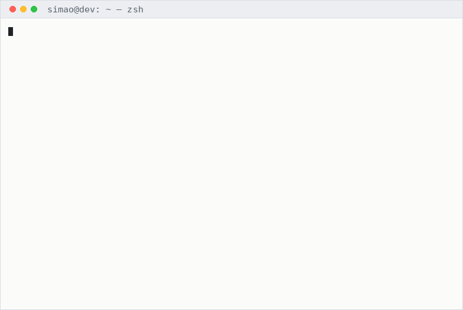

<picture>
  <source media="(prefers-color-scheme: dark)" srcset="assets/terminal-dark.gif">
  <source media="(prefers-color-scheme: light)" srcset="assets/terminal-light.gif">
  
</picture>

**CTO** at a product company in Porto — I lead the team and I'm making the company AI-first.
Before that: **Head of AI**, shipping a fleet of AI-powered microservices. Before that: a
**chatbot built alone**, six months in production. I care about the boring half — evals, cost per
request, model swaps, whoever is on call at 2am.

**Open to** AI Lead / Head of AI / CTO conversations → [LinkedIn](https://www.linkedin.com/in/simao-lopes)

Python · Go · Rust · TypeScript · CUDA/sm_70 · llama.cpp · vLLM · SQLite · systemd · Tailscale
